<a href="https://diegorezm.github.io"><picture><source media="(prefers-color-scheme: dark)" srcset="assets/hero-dark.svg"></picture></a>

<picture><source media="(prefers-color-scheme: dark)" srcset="assets/work-dark.svg"></picture>
<a href="https://github.com/diegorezm/grimo"><picture><source media="(prefers-color-scheme: dark)" srcset="assets/project-grimo-dark.svg"></picture></a>
<a href="https://github.com/diegorezm/meu-edital"><picture><source media="(prefers-color-scheme: dark)" srcset="assets/project-meu-edital-dark.svg"></picture></a>
