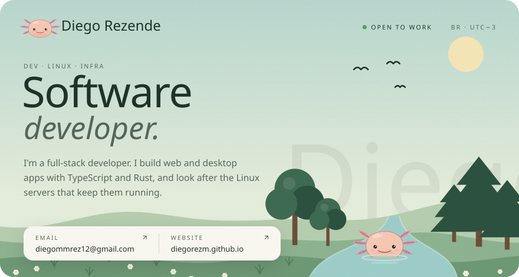

<!-- Generated by tools/build.py from profile.toml. Edit that file, not this one. -->
<a href="https://diegorezm.github.io"><picture><source media="(prefers-color-scheme: dark)" srcset="assets/header-dark.svg"></picture></a>

### Building

| | Project | Stack |
| :-- | :-- | :-- |
| `01` | **[Grimo](https://github.com/diegorezm/grimo)** A social network for readers: shelves, reviews, a feed and a monthly reading recap. Web and mobile. | `TypeScript · Cloudflare` |
| `02` | **[Meu Edital](https://github.com/diegorezm/meu-edital)** · [site ↗](https://meu-edital-site.diegommrez12.workers.dev) A free study planner for public exams: builds a study cycle from the exam weights and turns studying into a game. | `TypeScript · Kotlin · AI` |
| `03` | **[Leme](https://github.com/diegorezm/leme)** · [site ↗](https://diegorezm.github.io/leme/) A fast, minimal, local-first PDF reader for Windows. | `Rust · Slint` |
| `04` | **[dresume](https://github.com/diegorezm/dresume)** · [site ↗](https://diegorezm.github.io/dresume/) Resume workspaces powered by Typst: one template, many resumes. Desktop app and CLI, built for AI agents. | `Rust · Tauri · Svelte · Typst` |
| `05` | **[Pomolotl](https://github.com/diegorezm/pomolotl)** · [site ↗](https://diegorezm.github.io/pomolotl/) A free, cozy Pomodoro timer with an axolotl friend. Windows, Linux and macOS. | `Rust · egui` |
| `06` | **[dcom](https://github.com/diegorezm/dcom)** Lightweight, self-hostable community chat: a native desktop client with a Convex backend. | `Rust · Convex` |
| `07` | **[Distributed engineering path](https://github.com/diegorezm/distributed-eng-learning-path)** · [site ↗](https://diegorezm.github.io/distributed-eng-learning-path/) Learning distributed systems from scratch: replication, Raft, sharding, messaging and observability. | `HTML · JavaScript` |
| `08` | **[proposal-skill](https://github.com/diegorezm/proposal-skill)** A Claude Code skill that turns an AI plan into a one-page visual proposal you can review and answer in a minute. | `Python · HTML` |
| `09` | **[Sunaba](https://github.com/diegorezm/sunaba)** A themeable new-tab start page for Chromium browsers, customizable with JSON. | `HTML · CSS · JavaScript` |

### Done

| | Project | Stack |
| :-- | :-- | :-- |
| `10` | **[dtasks](https://github.com/diegorezm/dtasks)** A real-time project-management platform for companies and their customers. | `TypeScript · TanStack Start · Convex` |
| `11` | **[KVCluster](https://github.com/diegorezm/KVCluster)** A distributed key-value store built from scratch, inspired by Redis. | `Java 25` |
| `12` | **[eljobs](https://github.com/diegorezm/eljobs)** A job queue in pure Erlang/Elixir. | `Elixir` |
| `13` | **[LLM Notebook](https://github.com/diegorezm/llm-notebook)** Ask AI about your documents, fully offline, with a local LLM through Ollama. | `Rust · TypeScript · Ollama` |
| `14` | **[DFinance](https://github.com/diegorezm/DFinance)** A simple, local, ad-free personal finance app based on the 50/30/20 rule. | `Kotlin · SQLite · Android · iOS` |
| `15` | **[Lox interpreter](https://github.com/diegorezm/lox-interpreter)** An interpreter for the Lox language. | `Zig` |
| `16` | **[Space Invaders](https://github.com/diegorezm/space_invaders)** · [site ↗](https://diegorezm.github.io/space_invaders/) Space Invaders in C with raylib, compiled to WebAssembly. | `C · raylib · WebAssembly` |
